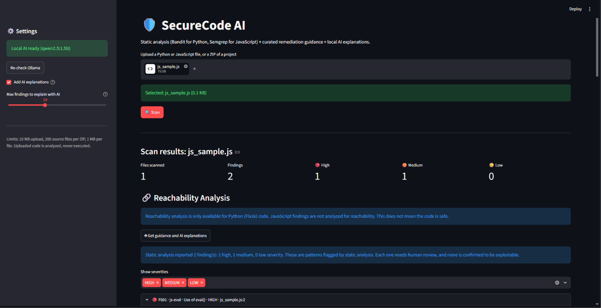
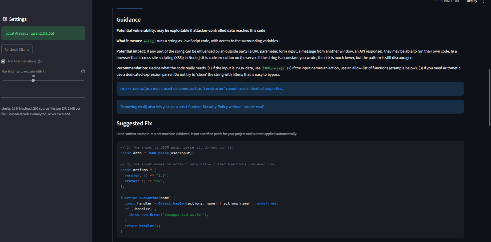
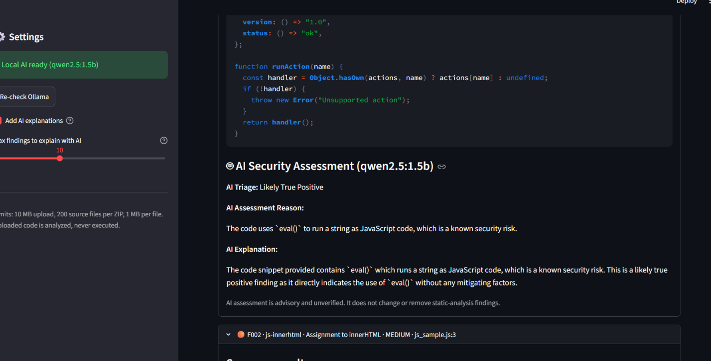

# 🛡️ SecureCode AI


**AI-Assisted Python and JavaScript Code Security Scanner**

SecureCode AI is a local, AI-assisted security analysis tool. It scans individual source files and project ZIP archives to find potentially risky coding patterns, explains them, and suggests how to fix them.

It combines **Bandit** (Python) and **Semgrep** (JavaScript) static analysis, a curated remediation knowledge base, a Flask reachability analysis module, and a locally running **Qwen 2.5 1.5B** language model through Ollama. Uploaded code is only analyzed, never executed, and nothing is sent to an external AI service.



## ✨ Features

- **Python and JavaScript scanning:** Upload a `.py` file, a `.js`/`.jsx`/`.mjs`/`.cjs` file, or a ZIP containing both.
- **Static analysis:** Bandit for Python, Semgrep with a small set of local rules for JavaScript.
- **One finding format:** Both scanners produce the same finding structure, so the guidance, AI and report layers work the same way for every language.
- **Flask reachability analysis (Python):** Finds supported Flask routes and checks which dangerous sinks they can reach.
- **Curated remediation guidance:** Hand-written explanations, impact statements, recommendations and example fixes.
- **AI triage and explanations:** A local model classifies each finding as likely true positive, likely false positive, or uncertain, and explains it.
- **Validation of AI output:** Responses are checked against a JSON schema and rejected when they overclaim, give fix advice, or contradict the code.
- **Suggested-fix validation (Python):** Example fixes are checked with AST parsing and Bandit before they are shown.
- **Reports:** Export results as Markdown or JSON.
- **Safe ZIP processing:** Path traversal, symlinks, zip bombs and oversized files are rejected or skipped.
- **Local processing:** The model runs through Ollama on your machine.
- **Automated tests:** A pytest suite and a GitHub Actions workflow.

## 🌐 Language support

| | Python | JavaScript |
|---|---|---|
| Scanner | Bandit | Semgrep with local rules (`rules/js_security.yml`) |
| Reachability analysis | Flask routes (prototype) | Not available |
| Curated guidance | Bandit test IDs | 4 rules: `eval()`, `new Function()`, `innerHTML` assignment, `document.write()` |
| Example fixes | Machine-checked (AST + Bandit) | Hand-written, **not** machine-validated |

JavaScript findings are reported with reachability `unknown`, which means "not analyzed", not "safe".

## 🖼️ Screenshots

| Guidance and suggested fix | AI assessment |
|---|---|
|  |  |

## 🏗️ Architecture

1. The user uploads a source file or a ZIP archive.
2. The application validates the upload. ZIP files are extracted safely, and only supported source files are written to disk.
3. Python files are analyzed by Bandit, JavaScript files by Semgrep. Nothing is executed.
4. Python files are also passed to the reachability module.
5. Findings from both scanners are merged into one list, sorted by severity, and given stable IDs (`F001`, `F002`, ...).
6. The remediation knowledge base adds curated guidance for each finding.
7. The local LLM produces a structured triage and explanation for the most severe findings.
8. AI responses are validated before they are accepted.
9. Python example fixes are validated separately.
10. Results are shown in the Streamlit dashboard and can be exported.

Scanner output is the only source of truth for a finding's ID, file, rule, severity, confidence and line. The AI never creates or changes these values.

### Reachability analysis (Python only)

The module uses Python AST parsing to inspect source code without executing it. It can:

- Discover supported Flask routes (`@app.route` and selected HTTP method decorators).
- Build a call graph from direct function calls and traverse it from each route handler.
- Detect selected dangerous sinks (such as `eval`, `exec` and certain command-execution calls) and selected user-input sources (such as `request.args.get`).
- Track simple variable aliases in supported cases.

Reachability analysis is a prototype, not a full taint-analysis engine. It does not cover all Flask routing patterns, cross-file data flows, complex aliases or dynamic dispatch. A reachable sink does not prove exploitability, and a missing result does not prove safety. Reachability is used for ranking only and never hides a finding.

### LLM reliability

- Structured JSON responses validated against a JSON schema.
- Restricted triage categories.
- Prompts that require evidence-based, cautious language.
- Rejection of unsupported claims (for example "guaranteed" or "remote code execution").
- Rejection of responses that give fix advice, since curated guidance provides fixes.
- Consistency checks for explicit contradictions, such as the wrong `shell=` value.

AI assessments are advisory and never change the scanner's findings, severity or confidence.

### Suggested-fix validation

Python example fixes are checked with AST parsing and Bandit: the original finding must disappear and no new HIGH or MEDIUM finding may appear. This is performed on an isolated snippet, so passing it does not prove that a fix is correct for a whole application. JavaScript examples are hand-written and are labeled as not machine-validated. Fixes are never applied automatically.

## 📊 Benchmark (AI triage, Python)

The AI triage was measured against findings that were labeled by hand as true or false positives.

- **Data:** 21 Bandit findings from 4 intentionally vulnerable Python projects: three open-source Flask apps and this project's own vulnerable sample (see [`benchmark/README.md`](benchmark/README.md))
- **Labels:** assigned by one person (the author)

| Model | Answered | Uncertain | Rejected | TP | FP | FN | TN | Precision | Recall | F1 |
|---|---:|---:|---:|---:|---:|---:|---:|---:|---:|---:|
| `qwen2.5:1.5b` (default) | 21 / 21 | 0 | 0 | 14 | 1 | 2 | 4 | 0.933 | 0.875 | 0.903 |
| `qwen2.5:7b` | 15 / 21 | 5 | 1 | 14 | 1 | 0 | 0 | 0.933 | 1.000 | 0.966 |

Run it with `python evaluate_ai.py`. Use the `OLLAMA_MODEL` environment variable to choose the model. Precision, recall and F1 are computed only on the findings a model answered ("uncertain" and rejected outputs are excluded), so read them together with the "Answered" column.

**How to read this:**

- `qwen2.5:1.5b` answers every finding, but it trusts the scanner too much. It called all four `shell=True` findings likely true positives, including the one labeled as a false positive, and it missed two real findings (an SQL-construction finding and a missing-timeout finding). It did correctly dismiss four import-only findings.
- `qwen2.5:7b` found the SQL-construction finding and made no false-negative errors, but it answered "uncertain" for five findings, including all four import-only false positives, and it never classified a finding as a likely false positive. One of its answers shows a limitation worth knowing: for a `shell=True` call that ran a constant command, the explanation said the case was safe while the triage still said likely true positive.
- 21 findings from 4 projects is a small sample, so a single decision moves the scores noticeably. Labels come from one person, each model was run once, and model output can vary between runs.
- The benchmark covers Python and Bandit only. **AI triage has not been evaluated on JavaScript findings.**

## 🧰 Technologies Used

| Technology | Purpose |
|---|---|
| Python | Main programming language |
| Streamlit | Interactive web interface |
| Bandit | Static Python security analysis |
| Semgrep | Static JavaScript security analysis |
| Python AST | Reachability analysis and fix validation |
| Ollama | Local LLM execution |
| Qwen 2.5 1.5B | AI explanations and triage |
| Pytest | Automated testing |
| GitHub Actions | Continuous integration |

## 📁 Project Structure

```text
securecode-ai/
│
├── .github/workflows/tests.yml     CI workflow
├── .streamlit/config.toml
│
├── app.py                          Streamlit dashboard
├── scanner.py                      Bandit scanning, file/ZIP routing
├── semgrep_scanner.py              Semgrep scanning (JavaScript)
├── findings.py                     Shared finding format
├── reachability.py                 Flask reachability analysis
├── analyzer.py                     Guidance + AI triage and validation
├── remediation_kb.py               Curated guidance (Bandit IDs + JS rules)
├── ollama_client.py                Ollama API client
├── safe_zip.py                     Safe ZIP extraction
├── report.py                       Markdown / JSON reports
│
├── rules/js_security.yml           Local Semgrep rules
├── samples/js_sample.js            JavaScript example for manual testing
├── docs/                           Screenshots
│
├── benchmark/                      Hand-made labels and results
├── evaluate_ai.py                  AI triage benchmark
├── evaluate_benchmark.py           Benchmark helper
├── label_findings.py               Helper for labeling findings
├── evaluation/                     Earlier prompt-level evaluation
│
├── requirements.txt
├── smoke_test.py
└── test_*.py                       Test suite
```

## ⚙️ Installation and Setup

### Prerequisites

- Python 3.10 or newer
- [Ollama](https://ollama.com/)
- Git

Semgrep (used for JavaScript) is installed with the project requirements. Semgrep Community Edition runs natively on Windows, macOS and Linux.

### 1. Clone the repository

```bash
git clone https://github.com/M4ryzs7/securecode-ai.git
cd securecode-ai
```

### 2. Create a virtual environment and install dependencies

**Windows PowerShell:**

```powershell
python -m venv .venv
.venv\Scripts\activate
python -m pip install -r requirements.txt
```

**macOS/Linux:**

```bash
python -m venv .venv
source .venv/bin/activate
python -m pip install -r requirements.txt
```

### 3. Install the local AI model

```bash
ollama pull qwen2.5:1.5b
```

Make sure Ollama is running before you request AI explanations. The scanner and the curated guidance work without it.

### 4. Run the application

```bash
python -m streamlit run app.py
```

The application is usually available at `http://localhost:8501`.

## 🔧 Ollama Configuration

| Variable | Default |
|---|---|
| `OLLAMA_MODEL` | `qwen2.5:1.5b` |
| `OLLAMA_BASE_URL` | `http://localhost:11434` |

**Windows PowerShell example:**

```powershell
$env:OLLAMA_MODEL = "qwen2.5:1.5b"
$env:OLLAMA_BASE_URL = "http://localhost:11434"
```

## 🚀 How to Use

1. Open SecureCode AI in your browser.
2. Upload a Python or JavaScript file, or a ZIP archive of a project.
3. Click **Scan**.
4. Review the findings, their severity, file and line.
5. For Python code, review the reachability analysis.
6. Click **Get guidance and AI explanations** to see curated guidance, suggested fixes and the AI assessment.
7. Download the results as a Markdown or JSON report.

To try JavaScript scanning, upload `samples/js_sample.js`.

## 🧪 Running Tests

```bash
python -m pytest -q
```

**Current verified test status: 196 passed.**

Tests that need a running Semgrep installation are skipped when it is not available. For a local integration check with Ollama:

```bash
python smoke_test.py
```

## 🔄 Continuous Integration

GitHub Actions runs the pytest suite on pushes to `main` and on pull requests targeting `main`. The workflow checks out the repository, sets up Python, installs the dependencies and runs the tests.

## ⚠️ Limitations

- Static analysis finds risky code patterns. It does not prove that a vulnerability is exploitable, and a clean scan does not guarantee that code is secure.
- JavaScript support is new: only four rules are included (`eval()`, `new Function()`, `innerHTML` assignment, `document.write()`), so many JavaScript issues are not detected.
- JavaScript findings have no reachability analysis, and their example fixes are hand-written and not machine-validated.
- Reachability analysis covers a limited set of Flask patterns, sources, sinks and direct function calls.
- AI triage and explanations are advisory and can be wrong. The benchmark is small (21 findings, labeled by one person) and covers Python only.
- Evidence-consistency validation covers only a limited set of explicit contradictions.
- Suggested fixes are checked as isolated snippets, not as complete project patches. Curated examples are illustrative and must be adapted and tested.
- Minified JavaScript files (`*.min.js`) and common dependency folders such as `node_modules` are skipped in ZIP uploads.

## 🔒 Security and Privacy

- Uploaded code is analyzed without being executed.
- AI explanations are generated by a local Ollama model. No code is sent to an external AI API.
- JavaScript scanning uses local rules, and Semgrep runs with metrics disabled.
- ZIP archives are subject to validation and extraction limits.
- Suggested code changes are never applied automatically.
- AI assessments do not replace manual security review.

## 👩‍💻 Author

**Maryam Salahli**

---

*SecureCode AI: making code security analysis more accessible through static analysis and local AI.*
